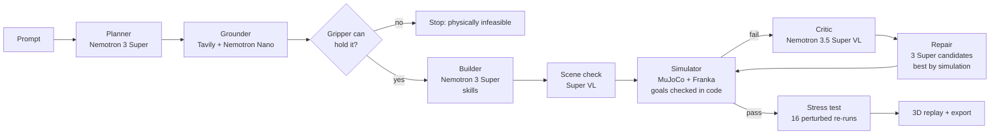

# Spec-to-Sim

> **Describe a robot task in plain English. Get a working, checked MuJoCo simulation, and watch the AI fix its own mistakes.**


**Track:** Physical AI · **Built for:** Nebius x NVIDIA Global AI Hackathon 2026
**Live demo:** _TBD_ · **Video:** _TBD (YouTube)_

---

## What it does

You type: *"Open the drawer, put the Rubik's cube inside, and close it."*

1. **Plan:** Nemotron 3 Super turns the sentence into a task spec: objects, and success goals that code can check (`inside(rubiks_cube, drawer)`, `closed(drawer)`).
2. **Ground:** Tavily searches the web for each object's real size and mass, and Nemotron Nano extracts the numbers with their source links. Code converts units and rejects implausible values.
3. **Build:** Nemotron 3 Super places the objects and writes the plan as skills (`pick`, `place_on`, `drop_into`, `push`; waypoints only for drawers). Code turns skills into waypoints from the real sizes and where things are. The model never writes code or robot XML.
4. **Simulate:** MuJoCo runs the Franka Panda (from MuJoCo Menagerie) through the plan. **Code checks every goal** against the final simulator state.
5. **Watch:** Nemotron 3.5 Super VL checks a render of the scene before the robot moves, and if a goal fails it looks at 8 frames from the run plus the measured failures and explains what went wrong.
6. **Repair:** Super writes 3 repair candidates in parallel, seeing every earlier attempt. Each is tested in the simulator (physics only, free) and the best one runs next. At most 4 attempts.
7. **Stress-test:** a successful plan is re-run 16 times, physics only. Each time every loose object starts up to 4 cm away and turned up to 30°, weighs ±20 % and has ±30 % friction, and the robot sees each object up to 0.5 cm from where it really is (like a camera's error). The result is a robustness score: plans with no margin for error score low.
8. **Generate training data:** one click turns the solved task into 20 successful demonstrations with varied starts, saved in the **LeRobot v2.1 dataset format** (Parquet + MP4, a format NVIDIA GR00T post-training also reads). The idea follows Isaac Lab Mimic: multiply demonstrations and keep the successful ones. We checked the files load with Hugging Face's `lerobot` (v0.3.3). We have **not** trained a policy on them yet, and the demonstrations come from our scripted top-down controller with the grasp assist (see limitations), so treat them as a starting point, not finished training data.

9. **Test your own policy:** every scene export includes `spec2sim_env.py` (MuJoCo + NumPy only: `reset(seed)` with the stress test's randomization, `step(action)`, `success()` with the same goal checks and tolerances) and `evaluate.py`, so a team can score any `act(obs)` policy on randomized versions of the scene: `python evaluate.py --policy my_policy.py --episodes 50`.
10. **Policy report card:** `scripts/train_policy.py` trains a small neural policy (an ensemble of five NumPy MLPs, ~40 s on a laptop CPU) on 100 generated demos and tests it on the same 16 perturbed variants as the scripted plan. It closes the loop from sentence to scene to data to policy to a measured weakness: the learned policy matches the plan on a simple stack (16/16) but drops to 4/16 placing a tennis ball on a cube (it grips about 1 cm high, so the ball rolls off) and 2/16 on a three-step task. These are behaviour-cloning results in our own simulator, with the grasp assist, not a robot result.

Every step streams live to the web app with the model that ran it, its time, tokens and cost, and a cascade strip lights up each stage as it runs. Each attempt replays **in 3D in the browser**, with the code's ✓/✗ verdict drawn on each object. **Before / after** shows the first failed attempt beside the repaired one on one clock and camera (or as a red "ghost"). **Move objects** lets you drag things to new spots and re-run the same plan, and **Edit facts** lets you correct any object's size, mass or friction and re-run: physics only, no model cost, so you can try to break it. **Export scene** downloads the generated scene (MuJoCo XML), the success checks and the motion plan, ready to test a robot policy against.

| | |
|---|---|


|  |  |
| **A real failure, measured by code.** The ball was let go 1.6 cm above the cube and rolled off. The Critic explained why, and Super's repair succeeded on attempt 2. | **Beyond pick-and-place.** Grip a drawer handle, pull it open, put two objects in, push it shut. Inspired by Isaac Lab's Franka drawer task, but simpler: a top-down grasp of a handle bar on a slide joint, with the cabinet placed by code. |

## Why it matters

Robotics teams spend days hand-building simulation scenes to test a single skill: measuring objects, writing XML, tuning placements, writing success checks. Spec-to-Sim does that from one sentence in about a minute, for a few cents:
- **Real-world grounding:** object sizes come from the web, with source links, so a soda can is 6.6 × 12.3 cm and 378 g, not a guess.
- **Checkable success:** goals are code predicates, using the vocabulary of NVIDIA's RoboLab benchmark (`object_on_top`, `object_in_container`, `object_left_of`, …). A vision model is never the judge (see below).
- **Reusable output:** the export is a MuJoCo scene plus success checks that a team can use to evaluate its own policy.
- **Robustness, not luck:** the stress test borrows the idea of Isaac Lab-Arena's sensitivity analysis, at a much smaller scale.

## What it can do

| Kind | Example prompts |
|---|---|
| Stack and place | "Stack three wooden toy blocks into a tower: red at the bottom, then green, then blue on top" |
| Sort into containers | "Put the apple and the lime into the fruit basket, and the soda can into the recycling bin" |
| Spatial goals | "Put the soda can to the left of the Rubik's cube and keep it upright" |
| Articulated objects | "Open the drawer, put the Rubik's cube inside, and close it" |
| Contact-rich, no grasp | "Knock over the tower of three wooden toy blocks" |
| Training data | Any solved task → 20 successful demonstrations in LeRobot format (fruit sorting: 3,340 frames in 77 s) |
| Says no when physics says no | An object wider than the gripper's 7.8 cm opening stops the run before any money is spent on repairs |

### Evaluation

Full results and method: [docs/eval.md](docs/eval.md). 104 runs on one commit, 3 runs per prompt, success decided by code:

| Suite | Success | First try | Model cost per task |
|---|---|---|---|
| **15 held-out prompts** (written and committed before any was run) | **42/45 (93 %, 95 % CI 82–98 %)** | 30/45 (67 %) | median $0.005 |
| 11 development prompts (the ones we built against) | 29/33 (88 %, CI 73–95 %) | 23/33 → 19/33 | median $0.006 |

- **What changed it:** the Builder writes skills and code computes the waypoints; each repair is 3 Super candidates tested in the simulator. We dropped escalation to Ultra after the first eval (it fixed 4 of 18 runs): cost per task fell from $0.013 to $0.009 with the same success rate.
- **Weak spots:** knocking things over (2 of 6 runs fail), and apples refused as too wide: 2–4 web sources agree they are 8.1–8.9 cm, and the gripper opens 8 cm.
- **Vision model:** turning the Critic off changed nothing measurable (23/26 vs 71/78), and the new pre-run scene check did not predict failures. We keep both for the explanations they show, and we don't claim they improve results.
- Median time per task: 38 s. All 104 runs cost $0.94 of model calls.

## How we use NVIDIA Nemotron on Nebius Token Factory

One OpenAI-compatible client and one API key; each pipeline step picks the model size it needs:

| Step | Model | Why this one |
|---|---|---|
| Planner, Builder, repair (3 candidates) | **Nemotron 3 Super** (120B, 12B active) | Reliable strict-schema JSON for multi-step plans at $0.30 / $0.90 per M tokens; cheap enough to sample 3 repairs and let the simulator pick |
| Grounder (fact extraction) | **Nemotron 3 Nano** (30B, 3B active) | Copying numbers and quotes from search results is easy; Nano does it in ~2 s for ~$0.0003 |
| Scene check, Critic | **Nemotron 3.5 Super VL** | Looks at the built scene before the run, and at an 8-frame contact sheet after a failure; with reasoning turned off a call takes ~2–3 s |
| (tested, then removed) | **Nemotron 3 Ultra** (550B, 55B active) | Escalated repairs fixed 4 of 18 runs in our first eval; 3 Super candidates checked by the simulator did as well for less |

**Where Token Factory accelerated the work:**
- **Swapping models is a one-word change.** We moved steps between Nano, Super and Ultra just by changing `model=`, so trying another size for a step took minutes.
- **Strict JSON schema output** (`response_format: json_schema`) made every step return data we can validate with Pydantic and feed back on error.
- **Turning reasoning off per call** (`chat_template_kwargs.enable_thinking=false`) cut the Critic from ~25 s to ~3 s and stopped it running out of tokens.
- **Cost is visible per call:** token counts from the API times published prices, logged for every call and shown in the UI. In the evaluation the median task cost $0.006 and the mean $0.013 (a hard failure can reach $0.23). All development, including the 104-run evaluation, cost about $4 of model calls. Prices are list prices as we found them; check them against the Token Factory console.

**Other Nebius services (packaged, not yet deployed):** the app and simulator are one CPU container (`Dockerfile`) meant for a **Nebius Serverless Endpoint**, and `scripts/eval.py` and `scripts/generate_data.py` are written as **Nebius Serverless Job** entrypoints (`deploy/nebius/README.md`). As of Oct 28 our Nebius AI Cloud account could not create registries or endpoints (`PermissionDenied`), so every eval and dataset in this repo ran locally.

## How we use Tavily: the reality check

Tavily's results change what gets simulated, not just what gets displayed:

| What Tavily grounds | How it changes the simulation | Integrity check |
|---|---|---|
| **Object size and mass** (product pages, standards, with photos) | Scene geometry and inertia | Up to 3 independent sources per object, shown as "N/M agree"; sizes far from the Planner's own estimate are rejected (a 2 mm lime); size vs weight, two out of three (a "20 cm, 246 g" grapefruit is really 8 cm) |
| **Material friction and bounciness** (engineering tables, measurements) | MuJoCo contact friction and restitution. Objects' contacts take priority over the floor's, so a slippery material really slides (a test checks μ 0.3 slides and μ 1.0 holds under the same push). Restitution goes through a measured MuJoCo calibration curve, so a rubber ball bounces like one | Per-material plausibility ranges; failures fall back to clearly labelled typical values |
| **Robot limits** (Franka datasheet: 80 mm gripper stroke, 3 kg payload, 855 mm reach) | The "physically infeasible" check before any build: object size from the web against gripper size from the datasheet | Quote must match the datasheet text |
| **Every number** | Carried into the scene export (`task.json`) and the LeRobot dataset metadata, so training data stays traceable to its sources | **Every quote must appear word for word in the text Tavily returned** (search result content, not the full page). A model once invented a spec-sheet quote with a real URL; it is now rejected |

Object searches are cached on disk (at most 3 per run). Material and robot facts form a shared, cached knowledge base (`scripts/build_physics_kb.py`), so later runs cost nothing extra.

**Also used:** **LangSmith** (every model call and simulator run traced; each run in the UI links to its trace).

## Design decisions that make it trustworthy

- **The models output data, never code.** Scenes and plans are Pydantic-validated JSON executed by our own fixed controller. No model-written Python or robot XML is ever run.
- **Code decides pass or fail; the vision model only explains.** Recent work shows why: on FailBench (2026), the best of 13 VLM success detectors reached 0.77 balanced accuracy, below 0.60 on contact-heavy tasks, and leaned toward saying "success" when unsure. Our Critic first describes what it sees in the frames, then quotes the measured failures (ground truth) before diagnosing. The UI shows the frames it watched. When nothing was simulated (the scene failed validation), the Critic is skipped: there is nothing to watch.
- **Guards against invented or faked results:** goals must name declared objects, web sizes far from the Planner's own estimate are rejected, a goal that already holds before the robot moves fails the attempt, and every scene problem is reported at once so one repair can fix them all.
- **Measured, not guessed, limits:** the workspace is where IK can actually reach with the gripper pointing down, mapped on a grid.

Details: [docs/research/](docs/research/) holds the sources behind each decision (Isaac Lab-Arena, RoboLab, FailBench, PhysBench, AnyTask, V-CAGE, Eureka and others).

## Architecture



More in [docs/architecture.md](docs/architecture.md) and the project logbook (`docs/explainer/index.html`).

## Quickstart

```bash
git clone https://github.com/atabak-eghbal/spec-to-sim && cd spec-to-sim
cp .env.example .env                 # add NEBIUS_API_KEY, TAVILY_API_KEY, LANGSMITH_API_KEY
uv sync
./scripts/fetch_menagerie.sh         # Franka Panda from MuJoCo Menagerie (pinned commit)
uv run uvicorn app.main:app          # web app at http://localhost:8000
```

- Command line: `uv run python -m spec2sim.cli "Knock over the tower of three wooden toy blocks"`
- Tests (no API calls): `uv run pytest`
- Batch eval: `uv run python scripts/eval.py --reps 3 --no-critic-reps 1`
- Training data from prompts (the Nebius Serverless Job entrypoint): `uv run python scripts/generate_data.py --episodes 50 "Knock over the tower of three wooden toy blocks"`
- Docker (CPU only): `docker build -t spec2sim . && docker run -p 8000:8000 --env-file .env spec2sim`

The recorded runs on the landing page replay without any API keys.

## Honest limitations

- **Grasp assist.** Fully physical grasping was too flaky to demo, so once both finger pads touch an object and it holds the fingers apart, a weld keeps it in the hand until the gripper opens. Closing above or beside an object grasps nothing (tested). The weld means held objects never slip, so grip force and the object's mass don't matter while it is carried. Placing, stacking, rolling, toppling, drawer sliding and falling are simulated normally.
- **The controller is simple.** Straight-line moves with the gripper pointing down, IK every tick, and perfect gravity compensation. No collision avoidance, no joint torque limits, no side grasps.
- **Physics calibration is narrow.** Restitution was calibrated with one ball dropped from 40 cm, so bounciness is most accurate near that case. Goals are checked once, 0.8 s after the last action.
- **Objects are simple shapes** (box, cylinder, sphere, open-top bin, drawer unit) with real sizes and masses. The "realistic" view only dresses them up in the browser.
- **One robot** (Franka Panda) with a top-down gripper. Plans are waypoint sequences run by our own controller, not a learned policy.
- **Model output varies run to run.** A prompt that passes first time once may need a repair the next time. The eval and stress test exist to measure that.
- **Real containers are rescaled** to tabletop size (a 97 cm curbside bin becomes 30 cm), and the UI says so.

## Repository map

| Path | What |
|---|---|
| `src/spec2sim/` | Pipeline: `planner.py`, `grounder.py`, `builder.py`, `critic.py`, `loop.py`, `schemas.py`, `llm.py` |
| `src/spec2sim/sim/` | MuJoCo: `scene.py` (objects, bins, drawers), `controller.py` (IK, grasp assist), `metrics.py` (goal checks), `runner.py` (run + stress test), `webviz.py` (3D replay data) |
| `app/` | FastAPI app, single-page UI, three.js viewer, recorded runs |
| `scripts/` | `eval.py`, `generate_data.py`, `resimulate.py` (re-run recorded runs on the current simulator), `fetch_menagerie.sh`, `add_viz.py` |
| `docs/` | Eval results, research notes, deployment, logbook |

## License

MIT, see [LICENSE](LICENSE). The robot model comes from [MuJoCo Menagerie](https://github.com/google-deepmind/mujoco_menagerie) (Apache-2.0) and is fetched at setup time. three.js (MIT) is vendored in `app/static/vendor/`.
