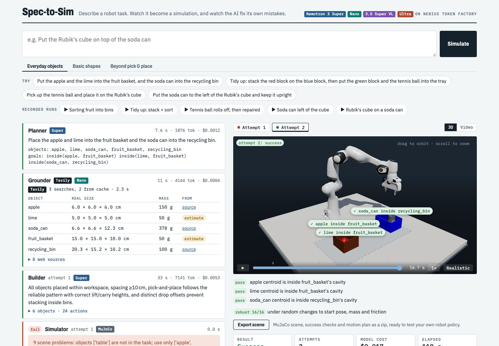
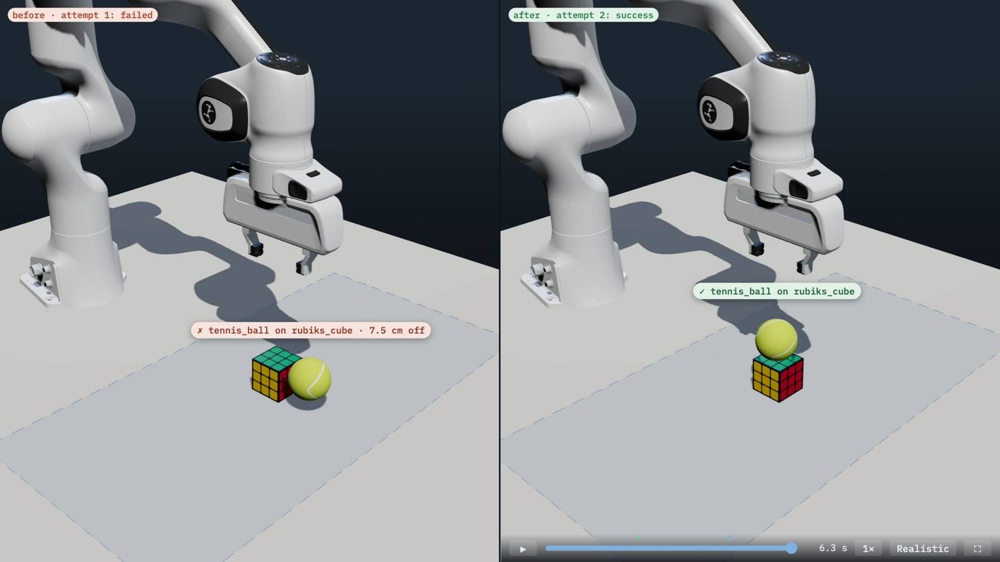
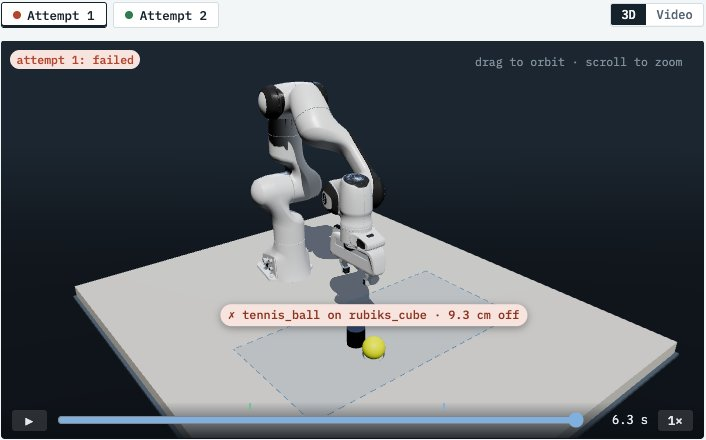
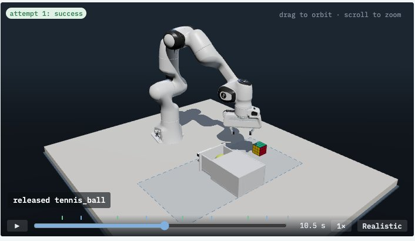
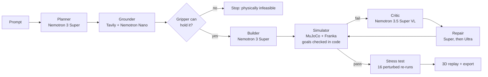

# Spec-to-Sim

> **Describe a robot task in plain English. Get a working, checked MuJoCo simulation, and watch the AI fix its own mistakes.**



**Track:** Physical AI · **Built for:** Nebius x NVIDIA Global AI Hackathon 2026
**Live demo:** _TBD_ · **Video:** _TBD (YouTube)_

---

## What it does

You type: *"Open the drawer, put the Rubik's cube inside, and close it."*

1. **Plan:** Nemotron 3 Super turns the sentence into a task spec: objects, and success goals that code can check (`inside(rubiks_cube, drawer)`, `closed(drawer)`).
2. **Ground:** Tavily searches the web for each object's real size and mass, and Nemotron Nano extracts the numbers with their source links. Code converts units and rejects implausible values.
3. **Build:** Nemotron 3 Super places the objects and writes a motion plan as data (waypoints, gripper open and close). It never writes code or robot XML.
4. **Simulate:** MuJoCo runs the Franka Panda (from MuJoCo Menagerie) through the plan. **Code checks every goal** against the final simulator state.
5. **Watch:** if a goal fails, Nemotron 3.5 Super VL looks at 8 frames from the run plus the measured failures, and explains what went wrong and how to fix it.
6. **Repair:** Super rewrites the plan. If that fails too, the repair **escalates to Nemotron 3 Ultra**. At most 4 attempts.
7. **Stress-test:** a successful plan is re-run 16 times with the objects nudged, turned, heavier or lighter and more or less slippery. The result is a robustness score, not a lucky run.
8. **Generate training data:** one click turns the solved task into 20 successful demonstrations with varied starts, saved in **LeRobot v2.1 format** (Parquet + MP4, the format NVIDIA GR00T post-training reads). It's the language-driven version of what Isaac Lab Mimic and NVIDIA's GR00T blueprint do: multiply demonstrations and keep the successful ones. Verified by loading it with Hugging Face's `lerobot` (v0.3.3).

Every step streams live to the web app with the model that ran it, its time, tokens and cost, and a cascade strip lights up each stage as it runs. Each attempt replays **in 3D in the browser**, with the code's ✓/✗ verdict drawn on each object. **Before / after** shows the first failed attempt beside the repaired one on one clock and camera (or as a red "ghost"). **Move objects** lets you drag things to new spots and re-run the same plan: physics only, no model cost, so you can try to break it. **Export scene** downloads the generated scene (MuJoCo XML), the success checks and the motion plan, ready to test a robot policy against.

| | |
|---|---|


|  |  |
| **A real failure, measured by code.** The ball was let go 1.6 cm above the cube and rolled off. The Critic explained why, and Super's repair succeeded on attempt 2. | **Beyond pick-and-place.** Open a drawer by its handle, put two objects in, push it shut. Modelled on Isaac Lab's Franka open-drawer task. |

## Why it matters

Robotics teams spend days hand-building simulation scenes to test a single skill: measuring objects, writing XML, tuning placements, writing success checks. Spec-to-Sim does that from one sentence in about a minute, for a few cents:
- **Real-world grounding:** object sizes come from the web, with source links, so a soda can is 6.6 × 12.3 cm and 378 g, not a guess.
- **Checkable success:** goals are code predicates, using the vocabulary of NVIDIA's RoboLab benchmark (`object_on_top`, `object_in_container`, `object_left_of`, …). A vision model is never the judge (see below).
- **Reusable output:** the export is a MuJoCo scene plus success checks that a team can use to evaluate its own policy.
- **Robustness, not luck:** the stress test is a small version of Isaac Lab-Arena's sensitivity analysis.

## What it can do (11/11 on our eval suite)

| Kind | Example prompts |
|---|---|
| Stack and place | "Stack three wooden toy blocks into a tower: red at the bottom, then green, then blue on top" |
| Sort into containers | "Put the apple and the lime into the fruit basket, and the soda can into the recycling bin" |
| Spatial goals | "Put the soda can to the left of the Rubik's cube and keep it upright" |
| Articulated objects | "Open the drawer, put the Rubik's cube inside, and close it" |
| Contact-rich, no grasp | "Knock over the tower of three wooden toy blocks" |
| Training data | Any solved task → 20 successful demonstrations in LeRobot format (fruit sorting: 3,340 frames in 77 s) |
| Says no when physics says no | An object wider than the gripper's 7.8 cm opening stops the run before any money is spent on repairs |

Batch evaluation (`scripts/eval.py`, results in [docs/eval.md](docs/eval.md)): the first round passed 4/8 tasks. Each failure was traced and fixed in code, not by retrying prompts until they passed. The third round passed **8/8 for $0.17 of model calls in total**, and the three drawer and knock-over tasks then passed 3/3 on the first try for $0.02.

## How we use NVIDIA Nemotron on Nebius Token Factory

One OpenAI-compatible client and one API key; each pipeline step picks the model size it needs:

| Step | Model | Why this one |
|---|---|---|
| Planner, Builder, first repair | **Nemotron 3 Super** (120B, 12B active) | Reliable strict-schema JSON for multi-step plans at $0.30 / $0.90 per M tokens |
| Grounder (fact extraction) | **Nemotron 3 Nano** (30B, 3B active) | Copying numbers and quotes from search results is easy; Nano does it in ~2 s for ~$0.0003 |
| Critic | **Nemotron 3.5 Super VL** | Reads an 8-frame contact sheet plus the measured failures; with reasoning turned off a critique takes ~3 s |
| Escalated repair | **Nemotron 3 Ultra** (550B, 55B active) | Only after Super's repair has already failed; deeper reasoning when it is worth paying for |

**Where Token Factory accelerated the work:**
- **Swapping models is a one-word change.** We moved steps between Nano, Super and Ultra just by changing `model=`. A step that failed with one size was re-run with another in minutes, which is how the cascade was tuned.
- **Strict JSON schema output** (`response_format: json_schema`) made every step return data we can validate with Pydantic and feed back on error.
- **Turning reasoning off per call** (`chat_template_kwargs.enable_thinking=false`) cut the Critic from ~25 s to ~3 s and stopped it running out of tokens.
- **Cost is visible per call:** token counts from the API times published prices, logged for every call and shown in the UI. A typical task costs $0.004–0.02. Our whole development cost about $1.

**Other Nebius services:** the app and simulator ship as one CPU container (`Dockerfile`) for a **Nebius Serverless Endpoint**, and `scripts/eval.py` runs as a **Nebius Serverless Job** (`deploy/nebius/README.md`).

**Also used:** **Tavily** (search for real-world object facts, cached on disk, at most 3 searches per run) and **LangSmith** (every model call and simulator run traced; each run in the UI links to its trace).

## Design decisions that make it trustworthy

- **The models output data, never code.** Scenes and plans are Pydantic-validated JSON executed by our own fixed controller. No model-written Python or robot XML is ever run.
- **Code decides pass or fail; the vision model only explains.** Recent work shows why: on FailBench (2026), the best of 13 VLM success detectors reached 0.77 balanced accuracy, below 0.60 on contact-heavy tasks, and leaned toward saying "success" when unsure. Our Critic receives the measured failures as ground truth and must quote its evidence before diagnosing.
- **Guards against invented or faked results:** goals must name declared objects, web sizes far from the Planner's own estimate are rejected, a goal that already holds before the robot moves fails the attempt, and every scene problem is reported at once so one repair can fix them all.
- **Measured, not guessed, limits:** the workspace is where IK can actually reach with the gripper pointing down, mapped on a grid.

Details: [docs/research/](docs/research/) holds the sources behind each decision (Isaac Lab-Arena, RoboLab, FailBench, PhysBench, AnyTask, V-CAGE, Eureka and others).

## Architecture



More in [docs/architecture.md](docs/architecture.md) and the project logbook (`docs/explainer/index.html`).

## Quickstart

```bash
git clone https://github.com/atabak-eghbal/spec-to-sim && cd spec-to-sim
cp .env.example .env                 # add NEBIUS_API_KEY, TAVILY_API_KEY, LANGSMITH_API_KEY
uv sync
./scripts/fetch_menagerie.sh         # Franka Panda from MuJoCo Menagerie (pinned commit)
uv run uvicorn app.main:app          # web app at http://localhost:8000
```

- Command line: `uv run python -m spec2sim.cli "Knock over the tower of three wooden toy blocks"`
- Tests (no API calls): `uv run pytest`
- Batch eval: `uv run python scripts/eval.py --reps 1`
- Docker (CPU only): `docker build -t spec2sim . && docker run -p 8000:8000 --env-file .env spec2sim`

The recorded runs on the landing page replay without any API keys.

## Honest limitations

- **Grasp assist.** When the closed gripper is within 2 cm of an object that fits between the fingers (≤ 7.8 cm), a weld holds it to the hand until the gripper opens. Fully physical grasping was too flaky to demo reliably. Everything else is physics: placing, stacking, rolling, toppling, drawer sliding, objects falling. The width limit is enforced, so the assist never holds something a real Panda couldn't.
- **Objects are simple shapes** (box, cylinder, sphere, open-top bin, drawer unit) with real sizes and masses. The "realistic" view only dresses them up in the browser.
- **One robot** (Franka Panda) with a top-down gripper. Plans are waypoint sequences run by our own controller, not a learned policy.
- **Model output varies run to run.** A prompt that passes first time once may need a repair the next time. The eval and stress test exist to measure that.
- **Real containers are rescaled** to tabletop size (a 97 cm curbside bin becomes 30 cm), and the UI says so.

## Repository map

| Path | What |
|---|---|
| `src/spec2sim/` | Pipeline: `planner.py`, `grounder.py`, `builder.py`, `critic.py`, `loop.py`, `schemas.py`, `llm.py` |
| `src/spec2sim/sim/` | MuJoCo: `scene.py` (objects, bins, drawers), `controller.py` (IK, grasp assist), `metrics.py` (goal checks), `runner.py` (run + stress test), `webviz.py` (3D replay data) |
| `app/` | FastAPI app, single-page UI, three.js viewer, recorded runs |
| `scripts/` | `eval.py`, `fetch_menagerie.sh`, `add_viz.py`, `add_stress.py` |
| `docs/` | Eval results, research notes, deployment, logbook |

## License

MIT, see [LICENSE](LICENSE). The robot model comes from [MuJoCo Menagerie](https://github.com/google-deepmind/mujoco_menagerie) (Apache-2.0) and is fetched at setup time. three.js (MIT) is vendored in `app/static/vendor/`.
