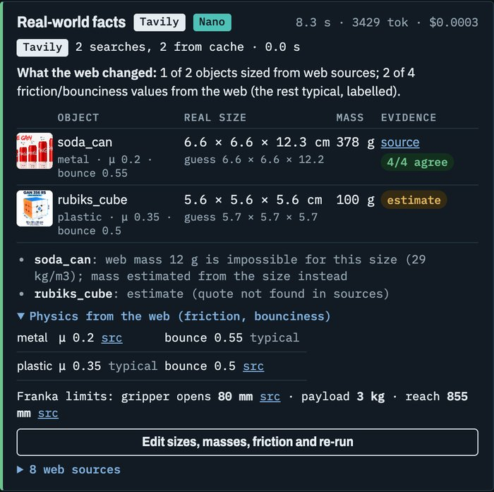
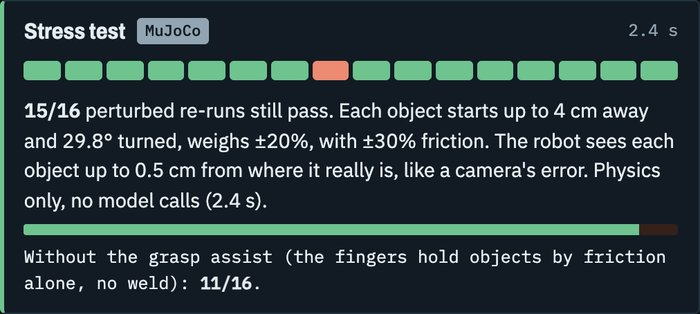
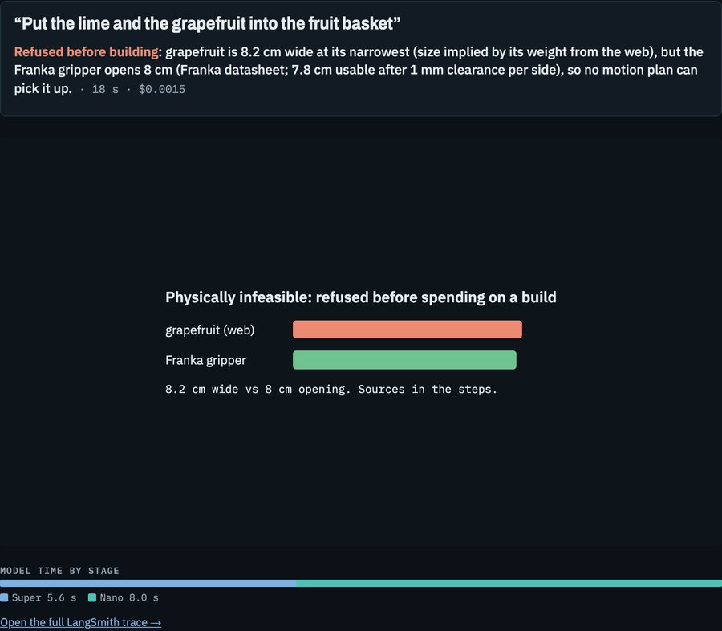
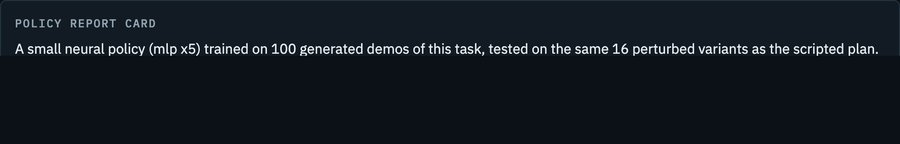
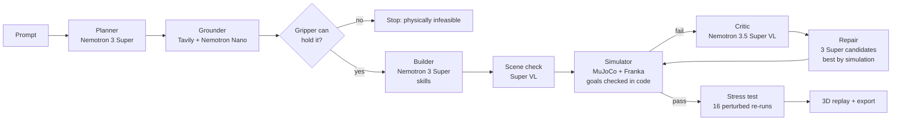

<div align="center">

# Spec-to-Sim

### One sentence in. A checked robot simulation out.

Type a robot task in plain English. Spec-to-Sim builds a MuJoCo scene from real-world facts found on the web, runs a Franka arm through it, and checks every goal in code. When a plan fails, NVIDIA Nemotron proposes three fixes and the simulator picks the one that works. Every solved task comes with a robustness score, training data, and a test harness for your own robot policy.

**[Live demo](https://austintransformer-spec-to-sim.hf.space)** · **[Demo video](https://youtu.be/HfrEUVrve4M)** · **[Evaluation](docs/eval.md)** · **[How it works](#how-it-works)**

[](#)
[](#how-we-use-nvidia-nemotron-on-nebius-token-factory)
[](#how-we-use-nvidia-nemotron-on-nebius-token-factory)
[](#how-we-use-tavily-the-reality-check)
[](https://mujoco.org)
[](LICENSE)

<a href="https://youtu.be/HfrEUVrve4M"></a>

<sub>Watch the 3-minute demo · Built for the Nebius x NVIDIA Global AI Hackathon 2026, Physical AI track</sub>

</div>

---

## At a glance

| | |
|---|---|
| **42 of 45** runs pass on 15 held-out prompts | **11 of 11** development prompts pass on the current code |
| **$0.004** median model cost per task | **38 s** median time per task |
| **3 Super repairs + a simulator** matched escalating to the 550B Ultra, at lower cost | **16** perturbed re-runs score every solved plan |

Numbers, method and caveats: [docs/eval.md](docs/eval.md). Pass or fail is always decided by code, never by a model.


## How it works

You type: *"Put the soda can to the left of the Rubik's cube and keep it upright."*

1. **Plan:** Nemotron 3 Super turns the sentence into objects and goals that code can check (`left_of(soda_can, rubiks_cube)`, `upright(soda_can)`).
2. **Ground:** Tavily searches the web for each object's real size and mass (reading full pages with `/extract` when snippets aren't enough), Nemotron Nano extracts the numbers with their sources, and code cross-checks them. Friction and bounciness come from engineering tables; the gripper's opening from Franka's datasheet. Impossible tasks are refused before anything is built.
3. **Build:** Super places the objects and writes the plan as skills (`pick`, `place_on`, `drop_into`, `push`). Our own controller turns skills into motion from the real sizes. The model never writes code or robot XML.
4. **Simulate and check:** MuJoCo runs the Franka Panda (from MuJoCo Menagerie). **Code checks every goal** against the final state.
5. **Repair:** if a goal fails, Nemotron 3.5 Super VL explains what went wrong from the frames, Super writes **three repair candidates in parallel**, the simulator tests each one in seconds, and the sturdiest runs next. At most 4 attempts.
6. **Stress-test:** a successful plan is re-run 16 times: objects moved up to 4 cm and turned up to 30°, ±20 % mass, ±30 % friction, and the robot's view up to 0.5 cm off. Plans with no margin score low.
7. **Use it:** export the scene with a policy test harness, or generate training data.

| The repair loop, live | Real-world facts from Tavily |
|---|---|
|  |  |
| **Three fixes, the simulator is the judge.** Each candidate is run in physics before it is chosen. | **Every number has a source.** Votes count only if the page was returned by Tavily and contains the number. |
|  |  |
| **Robust, or lucky?** One tile per perturbed re-run; hover a red one to see why it failed. | **Says no when physics says no.** Sizes from the web against the gripper's datasheet, before any money is spent. |

**What you get from a solved task**
- **A policy test harness:** every scene export includes `spec2sim_env.py` (MuJoCo + NumPy only: `reset(seed)` with the stress test's randomization, `step(action)`, `success()` with the same goal checks) and `evaluate.py`, so a team can score any `act(obs)` policy: `python evaluate.py --policy my_policy.py --episodes 50`.
- **Training data:** one click gives 20 successful demonstrations with varied starts in the **LeRobot v2.1 format** (Parquet + MP4, a format NVIDIA GR00T post-training also reads), checked to load with Hugging Face's `lerobot` (v0.3.3). They come from our scripted top-down controller with the grasp assist (see limitations), so treat them as a starting point.
- **A policy report card:** `scripts/train_policy.py` trains a small neural policy (five NumPy MLPs, ~40 s on a laptop CPU) on 100 generated demos and tests it on the same 16 variants as the scripted plan. It matches the plan on a simple stack (16/16) but drops to 4/16 placing a tennis ball on a cube (it grips about 1 cm high, so the ball rolls off). That is what a test is for. These are behaviour-cloning results in our own simulator, with the grasp assist; the learned policy sees true object poses while the scripted plan gets 0.5 cm sensing error; one training seed, 16 trials (4/16 has a 95 % CI of roughly 10–50 %).



**In the app,** every step streams live with the model that ran it, its time, tokens and cost. Each attempt replays **in 3D in the browser** with the code's ✓/✗ verdict on each object; **Before / after** puts the failed attempt beside the repaired one; **Move objects** and **Edit facts** let you drag things or correct a size, mass or friction and re-run the same plan (physics only, no model cost), so you can try to break it.

## Why it matters

Robotics teams spend days hand-building simulation scenes to test a single skill: measuring objects, writing XML, tuning placements, writing success checks. Spec-to-Sim does that from one sentence in about a minute, typically for under a cent:
- **Real-world grounding:** object sizes come from the web, with source links, so a soda can is 6.6 × 12.3 cm from a packaging spec; its 378 g is estimated from that size after the web's 15 g (an empty can) was rejected as impossible.
- **Checkable success:** goals are code predicates, using the vocabulary of NVIDIA's RoboLab benchmark (`object_on_top`, `object_in_container`, `object_left_of`, …). A vision model is never the judge (see below).
- **Reusable output:** the export is a MuJoCo scene plus success checks that a team can use to evaluate its own policy.
- **Robustness, not luck:** the stress test borrows the idea of Isaac Lab-Arena's sensitivity analysis, at a much smaller scale.

## What it can do

| Kind | Example prompts |
|---|---|
| Stack and place | "Stack three wooden toy blocks into a tower: red at the bottom, then green, then blue on top" |
| Sort into containers | "Put the apple and the lime into the fruit basket, and the soda can into the recycling bin" |
| Spatial goals | "Put the soda can to the left of the Rubik's cube and keep it upright" |
| Articulated objects | "Open the drawer, put the Rubik's cube inside, and close it" |
| Contact-rich, no grasp | "Knock over the tower of three wooden toy blocks" |
| Training data | Any solved task → 20 successful demonstrations in LeRobot format (fruit sorting: 3,340 frames in 77 s) |
| Your own policy | Any export → `evaluate.py` scores your `act(obs)` on randomized versions of the scene |
| Says no when physics says no | An object wider than the gripper's 7.8 cm opening stops the run before any money is spent on repairs |

### Evaluation

Full results and method: [docs/eval.md](docs/eval.md). 104 runs on one commit, 3 runs per prompt, success decided by code. Both 104-run evals predate the stricter grasp and "inside" checks added on Oct 29; the reasoning ablation below ran on the current code (11/11 with reasoning on).

| Suite | Success | First try | Model cost per task |
|---|---|---|---|
| **15 held-out prompts** (written and committed before any was run; see note) | **42/45 (93 %, 95 % CI 82–98 %)**; 39/42 without the one should-refuse prompt | 30/45 (67 %) | median $0.005 |
| 11 development prompts (the ones we built against) | 29/33 (88 %, CI 73–95 %) | 23/33 → 19/33 | median $0.006 |

- **Note on "held out":** the 15 prompts were frozen before round 1 and never tuned. But two of their round-1 failures (a planner "table" object, an orange refusal) did prompt general code fixes before round 2, so round 2 is not a fully blind test. Round 1 (41/45, before those fixes) is the clean held-out number.
- **What changed it:** the Builder writes skills and code computes the waypoints; each repair is 3 Super candidates tested in the simulator. We dropped escalation to Ultra after the first eval (it fixed 4 of the 10 runs escalated to it, 4 of 18 attempts): mean cost per task fell from $0.013 to $0.010 with the same success rate.
- **Weak spots:** knocking things over (2 of 6 runs fail), and apples refused as too wide. That last one was partly our bug: the size check counted a source as agreeing with itself, with a loose 20 % band, so one farm guide's 8.9 cm apple could stop a task. Now sizes use the median of 3+ sources and only independent sources within 8 % count; re-grounding the 7 refused apple runs, 6 now go ahead.
- **Vision model:** turning the Critic off changed nothing measurable (23/26 vs 71/78), and the new pre-run scene check did not predict failures. We keep both for the explanations they show, and we don't claim they improve results.
- Median time per task: 38 s. All 104 runs cost $0.94 of model calls.

## How we use NVIDIA Nemotron on Nebius Token Factory

One OpenAI-compatible client and one API key; each pipeline step picks the model size it needs.

**The main finding: test-time compute plus a verifier matched a bigger model at lower cost.** In our first eval, failed attempts were escalated to Nemotron 3 Ultra (550B): it fixed 4 of the 10 runs escalated to it (4 of 18 attempts), and its 67 calls were 48 % of all our model spend ($2.38 of $5.00), at a median 32 s and 8,500 output tokens each. We replaced it with three Nemotron Super repairs sampled in parallel, each tested in MuJoCo in seconds, and the best one runs: 26 of 46 repairs fixed the run, and mean cost per task fell from $0.013 to $0.010 (Critic-on runs) with the same success rate, 70/78 vs 71/78. (The two evals also differ in other code changes, so this is not a controlled A/B.)

| Model | Calls | Median latency | Median output tokens | Spend |
|---|---|---|---|---|
| Nemotron 3 Super | 799 | 9.6 s | 1,631 | $2.33 |
| Nemotron 3 Nano | 333 | 7.1 s | 621 | $0.11 |
| Nemotron 3.5 Super VL | 214 | 1.9 s | 339 | $0.17 |
| Nemotron 3 Ultra (removed) | 67 | 32.5 s | 8,506 | $2.38 |

From `.cache/spend.jsonl`, every call made while building and evaluating the project (1,413 calls, $5.00).


| Step | Model | Why this one |
|---|---|---|
| Planner, Builder, repair (3 candidates) | **Nemotron 3 Super** (120B, 12B active) | Reliable strict-schema JSON for multi-step plans at $0.30 / $0.90 per M tokens; cheap enough to sample 3 repairs and let the simulator pick |
| Grounder (fact extraction) | **Nemotron 3 Nano** (30B, 3B active) | Copying numbers and quotes from search results is easy; Nano does it for ~$0.0003 a call (median 7 s, most of it reading long search results) |
| Scene check, Critic | **Nemotron 3.5 Super VL** | Looks at the built scene before the run, and at an 8-frame contact sheet after a failure; with reasoning turned off a call takes ~2–3 s |
| (tested, then removed) | **Nemotron 3 Ultra** (550B, 55B active) | Escalated repairs fixed 4 of the 10 runs escalated to it (4 of 18 attempts) in our first eval; 3 Super candidates checked by the simulator did as well for less |

**Where Token Factory accelerated the work:**
- **Swapping models is a one-word change.** We moved steps between Nano, Super and Ultra just by changing `model=`, so trying another size for a step took minutes.
- **Ultra taught us something about strict output:** even with `response_format: json_schema`, Ultra sometimes wrote its reasoning before the JSON, so `llm.py` keeps a small recovery step that takes the last JSON object in the reply.
- **Strict JSON schema output** (`response_format: json_schema`) made every step return data we can validate with Pydantic and feed back on error.
- **Turning reasoning off per call** (`chat_template_kwargs.enable_thinking=false`) cut the vision calls from ~25 s to a 1.9 s median and stopped them running out of tokens. For planning and repair we measured it: on the 11 development prompts (current code, Oct 29), Super with reasoning on passed **11/11** (9 first try) at a median $0.0055 per task; with reasoning off, **6/11** (1 first try) at $0.0108, because the extra failed attempts cost more than the reasoning tokens saved. So reasoning stays on where the model plans, and off where it reads or looks.
- **Cost is visible per call:** token counts from the API times published prices, logged for every call and shown in the UI. In the round-2 evaluation the median task cost $0.004 and the mean $0.009 (most expensive run $0.057). All development, including two 104-run evaluations, cost $5.00 of model calls (table above). Prices are list prices as we found them; check them against the Token Factory console.

**Other Nebius services (packaged, not yet deployed):** the app and simulator are one CPU container (`Dockerfile`) meant for a **Nebius Serverless Endpoint**, and `scripts/eval.py` and `scripts/generate_data.py` are written as **Nebius Serverless Job** entrypoints (`deploy/nebius/README.md`). As of Oct 28 our Nebius AI Cloud account could not create registries or endpoints (`PermissionDenied`), so every eval and dataset in this repo ran locally, and the public demo runs on a free Hugging Face Space. Token Factory serves every model call in both.

## How we use Tavily: the reality check

Tavily's results change what gets simulated, not just what gets displayed:

| What Tavily grounds | How it changes the simulation | Integrity check |
|---|---|---|
| **Object size and mass** (product pages, standards, with photos) | Scene geometry and inertia | Up to 3 independent sources per object, shown as "N/M agree"; sizes far from the Planner's own estimate are rejected (a 2 mm lime); size vs weight, two out of three (an "18 cm, 246 g" grapefruit is really 8 cm) |
| **Material friction and bounciness** (engineering tables, measurements; Tavily advanced search, then `/extract` reads the top two pages' relevant passages) | MuJoCo contact friction and restitution. Objects' contacts take priority over the floor's, so a slippery material really slides (a test checks μ 0.3 slides and μ 1.0 holds under the same push). Restitution goes through a measured MuJoCo calibration curve, so a rubber ball bounces like one | Per-material plausibility ranges, and a context check: the quote must name the material and, for friction, a dry wood/table surface ("wood on **wet** metal" or a worked example is rejected). 8 of 22 values are web-sourced; the rest are labelled typical values. Tables often list static and kinetic friction side by side; we take the value the quote gives |
| **Robot limits** (Franka datasheet: 80 mm gripper stroke, 3 kg payload, 855 mm reach) | The "physically infeasible" check before any build: object size from the web against gripper size from the datasheet | Quote must match the datasheet text |
| **Every number** | Carried into the scene export (`task.json`) and the LeRobot dataset metadata, so training data stays traceable to its sources | **Every quote must appear word for word in the text Tavily returned** (search result content, not the full page). A model once invented a spec-sheet quote with a real URL; it is now rejected |

Object searches are cached on disk (at most 3 per run). When no search snippet contains a size, Tavily `/extract` reads the top two pages (only the passages about the query, at most twice per run). An "N/M agree" vote counts only if its page was returned by Tavily, counts once, and contains the number. The app's facts card shows the Planner model's own size guess under each web value, and a line saying how much the web changed. Material and robot facts form a shared, cached knowledge base (`scripts/build_physics_kb.py`), so later runs cost nothing extra.

**Also used:** **LangSmith** (every model call and simulator run traced; each run in the UI links to its trace).

## Design decisions that make it trustworthy

- **The models output data, never code.** Scenes and plans are Pydantic-validated JSON executed by our own fixed controller. No model-written Python or robot XML is ever run.
- **Code decides pass or fail; the vision model only explains.** Recent work shows why: on FailBench (2026), the best of 13 VLM success detectors reached 0.77 balanced accuracy, below 0.60 on contact-heavy tasks, and leaned toward saying "success" when unsure. Our Critic first describes what it sees in the frames, then quotes the measured failures (ground truth) before diagnosing. The UI shows the frames it watched. When nothing was simulated (the scene failed validation), the Critic is skipped: there is nothing to watch.
- **Guards against invented or faked results:** goals must name declared objects, web sizes far from the Planner's own estimate are rejected, a goal that already holds before the robot moves fails the attempt, and every scene problem is reported at once so one repair can fix them all.
- **Measured, not guessed, limits:** the workspace is where IK can actually reach with the gripper pointing down, mapped on a grid.

Details: [docs/research/](docs/research/) holds the sources behind each decision (Isaac Lab-Arena, RoboLab, FailBench, PhysBench, AnyTask, V-CAGE, Eureka and others).

## Architecture



More in [docs/architecture.md](docs/architecture.md) and the project logbook (`docs/explainer/index.html`).

## Quickstart

```bash
git clone https://github.com/atabak-eghbal/spec-to-sim && cd spec-to-sim
cp .env.example .env                 # add NEBIUS_API_KEY, TAVILY_API_KEY, LANGSMITH_API_KEY
uv sync
./scripts/fetch_menagerie.sh         # Franka Panda from MuJoCo Menagerie (pinned commit)
uv run uvicorn app.main:app          # web app at http://localhost:8000
```

- Command line: `uv run python -m spec2sim.cli "Knock over the tower of three wooden toy blocks"`
- Tests (no API calls): `uv run pytest`
- Batch eval: `uv run python scripts/eval.py --reps 3 --no-critic-reps 1`
- Training data from prompts (the Nebius Serverless Job entrypoint): `uv run python scripts/generate_data.py --episodes 50 "Knock over the tower of three wooden toy blocks"`
- Docker (CPU only): `docker build -t spec2sim . && docker run -p 8000:8000 --env-file .env spec2sim`

The recorded runs on the landing page replay without any API keys.

## Honest limitations

- **Grasp assist.** Fully physical grasping was too flaky to demo, so once both finger pads touch an object and it holds the fingers apart, a weld keeps it in the hand until the gripper opens. The object's center must lie between the fingers and the pads must be below its top: closing above it, beside it, or with one fingertip resting on it grasps nothing (tested, including a probe a reviewer used to break an earlier version). The weld means held objects never slip. So we also measure without it: every stress test re-runs the same 16 variants with the assist off, fingers holding by friction alone, and the app shows both scores (featured runs: 5/16 to 16/16 without it, e.g. tennis ball on a cube 16 → 9). Placing, stacking, rolling, toppling, drawer sliding and falling are simulated normally.
- **The controller is simple.** Straight-line moves with the gripper pointing down, IK every tick, and perfect gravity compensation. No collision avoidance, no joint torque limits, no side grasps.
- **Physics calibration is narrow.** Restitution was calibrated with one ball dropped from 40 cm, so bounciness is most accurate near that case. Goals are checked once, 0.8 s after the last action.
- **Objects are simple shapes** (box, cylinder, sphere, open-top bin, drawer unit) with real sizes and masses. The "realistic" view only dresses them up in the browser.
- **One robot** (Franka Panda) with a top-down gripper. Plans are waypoint sequences run by our own controller, not a learned policy.
- **Model output varies run to run.** A prompt that passes first time once may need a repair the next time. The eval and stress test exist to measure that.
- **Real containers are rescaled** to tabletop size (a 97 cm curbside bin becomes 30 cm), and the UI says so.

## Repository map

| Path | What |
|---|---|
| `src/spec2sim/` | Pipeline: `planner.py`, `grounder.py`, `builder.py`, `critic.py`, `loop.py`, `schemas.py`, `llm.py` |
| `src/spec2sim/sim/` | MuJoCo: `scene.py` (objects, bins, drawers), `controller.py` (IK, grasp assist), `metrics.py` (goal checks), `runner.py` (run + stress test), `webviz.py` (3D replay data) |
| `app/` | FastAPI app, single-page UI, three.js viewer, recorded runs |
| `scripts/` | `eval.py`, `generate_data.py`, `resimulate.py` (re-run recorded runs on the current simulator), `fetch_menagerie.sh`, `add_viz.py` |
| `docs/` | Eval results, research notes, deployment, logbook |

## License

MIT, see [LICENSE](LICENSE). The robot model comes from [MuJoCo Menagerie](https://github.com/google-deepmind/mujoco_menagerie) (Apache-2.0) and is fetched at setup time. three.js (MIT) is vendored in `app/static/vendor/`.
