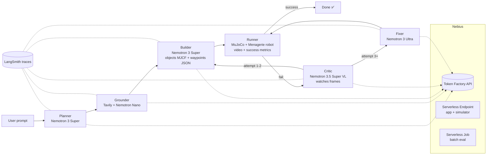

# Architecture



## Data contracts (Pydantic, in `src/spec2sim/schemas.py`)
- `TaskSpec` — robot, objects (name, shape, color), goal predicates (`on(a,b)`, `inside(a,b)`, `at(a,xyz)`), tolerances
- `GroundedFacts` — per object: size, mass, source URL (from Tavily)
- `SceneObjects` — MJCF `<body>` fragment for objects only (robot comes from Menagerie)
- `MotionPlan` — list of actions: `move_to(xyz, quat)`, `open_gripper`, `close_gripper`, `wait(s)`
- `RunResult` — success bool, per-predicate errors, video path, sampled frame paths
- `Critique` — failure category, explanation, suggested change

## Planned module layout
```
src/spec2sim/
  config.py      # env + model IDs + price table
  llm.py         # one wrapped OpenAI client (LangSmith), cost/latency logging, routing
  schemas.py     # contracts above
  planner.py  grounder.py  builder.py  critic.py  fixer.py
  sim/
    scene.py     # merge Menagerie robot + objects fragment
    controller.py# mink IK → joint targets, gripper, attach fallback
    metrics.py   # success predicates computed from sim state
    render.py    # MP4 + frame sampling
  loop.py        # orchestration + iteration/escalation policy, yields events
  cli.py
app/
  main.py        # FastAPI + SSE
  static/        # single-page UI
worker/          # batch-eval entrypoint for Serverless Job
deploy/nebius/   # Dockerfile, endpoint/job create scripts
```
